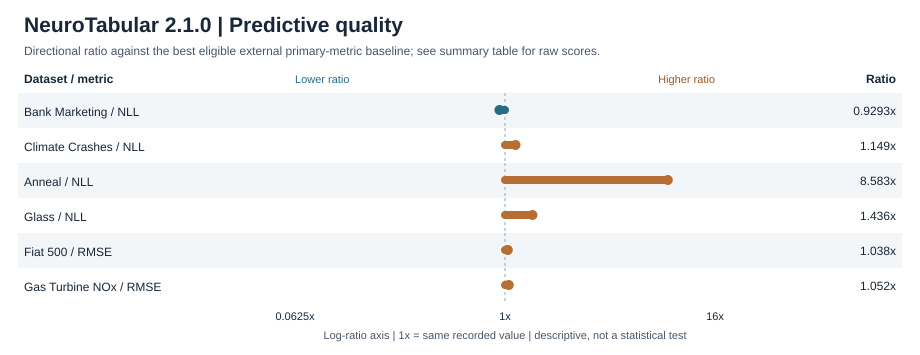
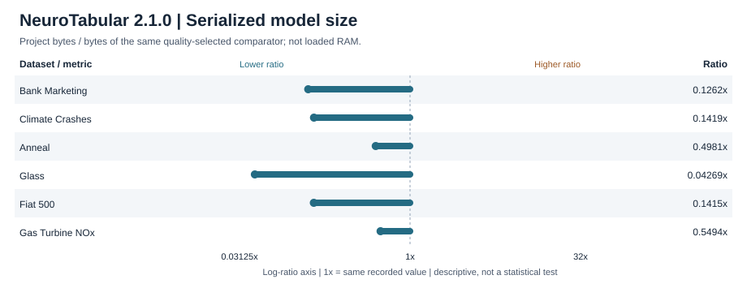

# NeuroTabular benchmarks

**Competitive evidence: NeuroTabular 2.1.0 and 2.0.0, six-family CPU pilot.**

## Scope and coverage

| Item | Recorded scope |
|---|---|
| Evaluated release | 2.1.0, with 2.0.0 as a version reference |
| Comparators | RealMLP, XGBoost, LightGBM, CatBoost, TabM, FT-Transformer |
| Dataset families | 6 (two per task) |
| Regimes | Default and four-candidate tuning, kept separate; three seeds |
| Final endpoints | 181 measured / 288 planned; 107 unavailable |
| Reproducibility | Executable frozen protocol; exact environment, data and frozen wheels required |

## Predictive performance

The common overview uses the default regime and medians of all three measured seeds, against the best fully covered external baseline for the primary metric (NLL for classification, RMSE for regression). The historical 2.0.0 version reference is excluded from this descriptive comparison; partial methods are not ranked. The full scorecard retains all fully covered methods and both regimes.

[Summary table](overview/SUMMARY.md) · [Complete scorecard](competitive/SCORECARD.md) · [Per-seed results](competitive/results/tables/PER_SEED.csv)

## Computational efficiency

Size is the serialized model, not process RAM or installation size. The summary table compares training CPU, process RSS and stored bytes with the same quality-selected comparator. Only 2 of 36 dedicated inference A/A controls pass; do not generalize speed ratios from invalid controls.

[Measurement definitions](competitive/MEASUREMENT_SCOPE.md) · [Timing controls](competitive/results/tables/TIMING_CONTROLS.csv) · [Detailed figures](FIGURES.md)

## Quality-resource trade-offs

Bank Marketing favors NeuroTabular on median NLL; the held-out Climate study favors it on balanced accuracy but CatBoost has lower NLL. Trees win substantially on Anneal and Glass. Local point frontiers are descriptive, not confidence-qualified dominance. [When to choose NeuroTabular](competitive/WHEN_TO_CHOOSE.md).

## Methodology and reproducibility

The fixed TRAIN/validation/TEST roles, dataset group rules, models, seeds, qualification and measurement gates are documented in the [protocol](competitive/PROTOCOL.md), [datasets](competitive/DATASETS.md), [methods](competitive/METHODS.md) and [reproduction guide](competitive/README.md). The guide explains the frozen Windows CPU environment, wheel identities, permitted data preparation and explicit execution. No new model fitting is needed to regenerate this overview: `python benchmarks/plot_overview.py` reads the recorded CSV only. The original detailed tables and paired figures have their own reproduction commands and custody records.

## Complete results and figures

| Report | Contents |
|---|---|
| [Complete scorecard](competitive/SCORECARD.md) | All complete methods, both regimes, failures and comparisons |
| [Original report](competitive/results/REPORT.md) | Frozen result interpretation |
| [Detailed figures](FIGURES.md) | Original PNG plots, paired intervals and common SVG overview |
| [Numerical data](competitive/results/README.md) | Full precision JSON, CSV and status |
| [Historical evidence](../docs/BENCHMARK_0_3.md) | Earlier protocols and versions, kept separate |
| [Performance evidence](../docs/PERFORMANCE_0_3_1.md) | Historical measurements |

## Limitations

Six families and three seeds do not establish universal superiority or independent confirmation. Unavailable comparisons are not losses or wins; measured incomplete methods are not ranked on surviving cells. Raw data, model weights and private laboratory records are excluded. No new fits, scoring or timing were performed to produce this overview.
